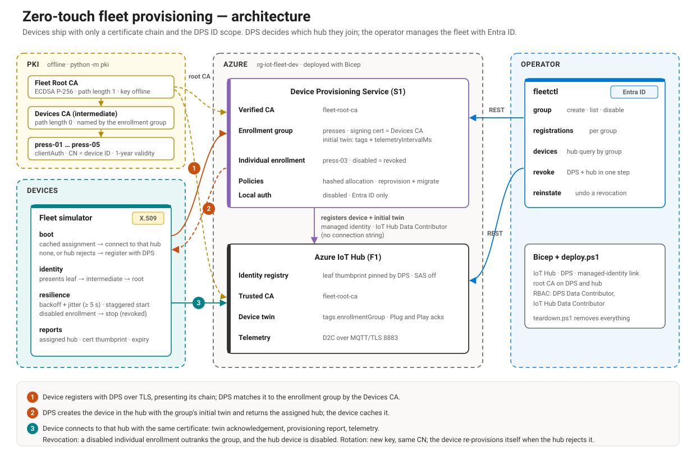
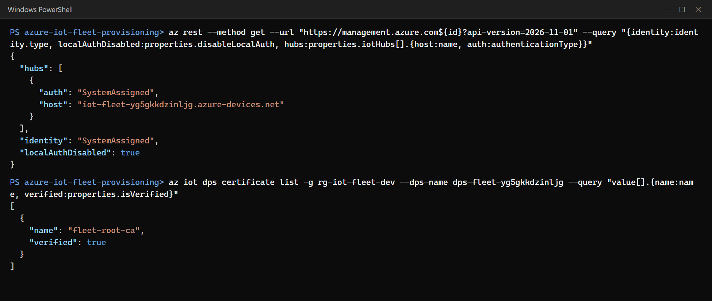
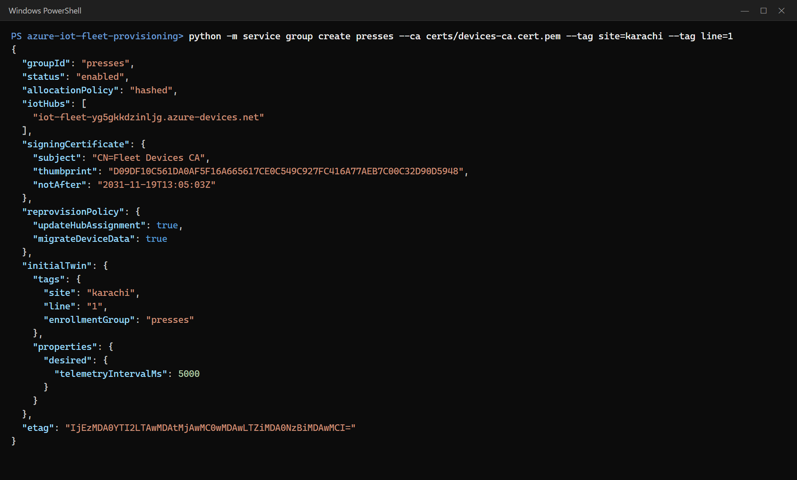
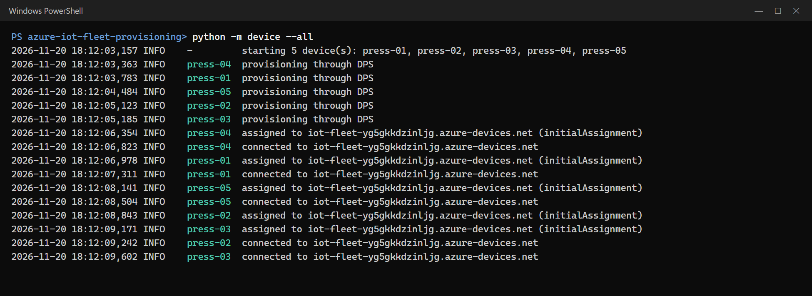
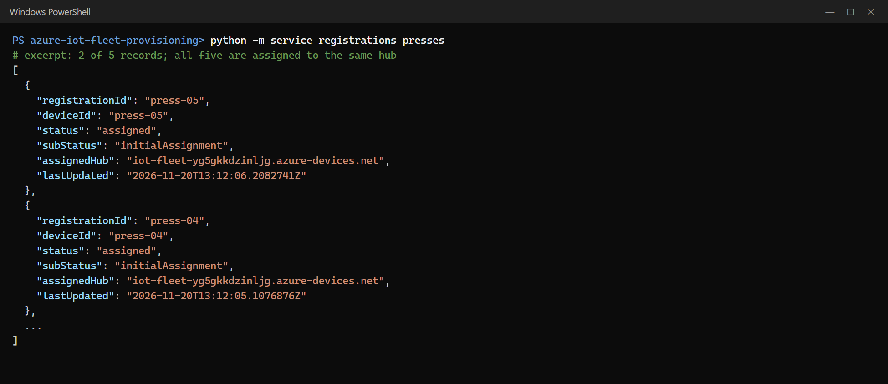
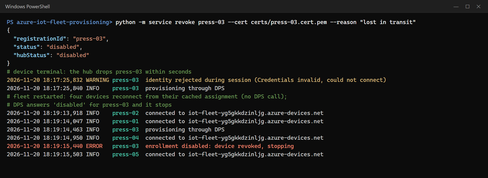
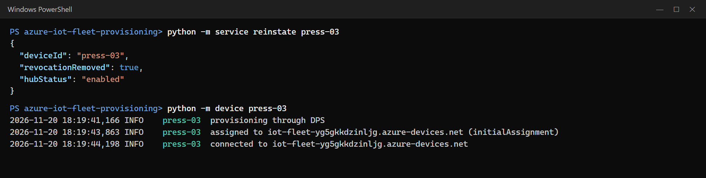
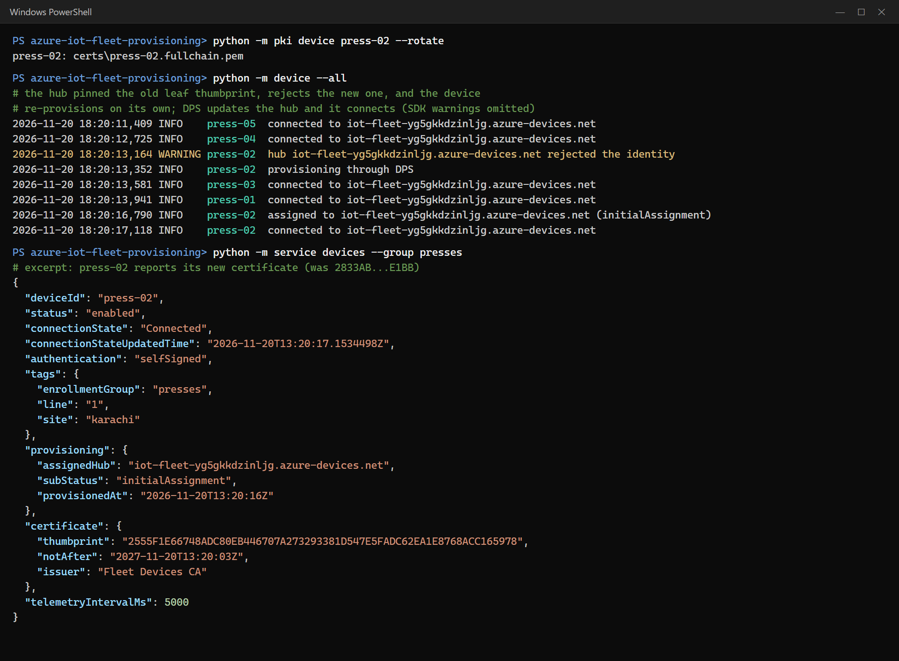
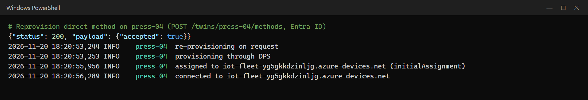

# Azure IoT Fleet Provisioning

> Zero-touch onboarding for a device fleet with Azure IoT Hub Device Provisioning Service:
> a three-level X.509 PKI, an enrollment group, one-step revocation, and certificate rotation.
> No shared keys or connection strings anywhere.



Each simulated press ships with only its certificate chain and the DPS ID scope. On first
boot it registers with DPS, which matches it to an enrollment group by its issuing CA, creates
it in IoT Hub with an initial twin, and tells it which hub to use. The operator manages the
fleet with `fleetctl` using their Microsoft Entra ID sign-in.

## What it demonstrates

| Capability | How |
|------------|-----|
| **Three-level PKI** | Root CA → Devices CA → device, ECDSA P-256, path-length limits, `clientAuth` EKU ([ADR 0001](docs/adr/0001-three-level-pki-and-enrollment-group.md)) |
| **Zero-touch provisioning** | X.509 enrollment group on the intermediate; CN becomes the device ID; initial twin sets tags and the telemetry interval |
| **Device-side discipline** | Cached assignment (no DPS call per boot), re-provision on rejection, backoff with jitter, staggered start, never gives up unless revoked ([ADR 0003](docs/adr/0003-device-provisioning-behaviour.md)) |
| **Revocation** | Disabled individual enrollment plus disabled hub device, in one command ([ADR 0004](docs/adr/0004-revocation-and-rotation.md)) |
| **Rotation** | New key, same CN; the hub rejects the new leaf, the device re-provisions itself, no operator step |
| **Re-provisioning** | `Reprovision` direct method; *reprovision and migrate data* policy keeps the twin |

## Security

- **Devices:** X.509 only. Device and module SAS are disabled on the hub.
- **Operator:** Entra ID via `az login`. DPS has **local auth disabled**, so its keys cannot be used.
- **DPS → IoT Hub:** DPS's managed identity with *IoT Hub Data Contributor*; no connection string
  ([ADR 0002](docs/adr/0002-entra-id-rest-and-managed-identity-link.md)).
- **Least privilege:** the operator gets *Device Provisioning Service Data Contributor* on DPS and
  *IoT Hub Data Contributor* on the hub, scoped to those resources.
- **Keys on disk** are written owner-only and gitignored; the root key is needed only to issue intermediates.

## Quickstart

**Prerequisites:** Python 3.11+, Azure CLI (`az login`, `az bicep install`), and a subscription
with no existing F1 IoT hub (Azure allows one per subscription).

```powershell
# 1. Python environment
python -m venv .venv; .venv\Scripts\activate
pip install -r requirements-dev.txt

# 2. PKI: root, intermediate, five devices
python -m pki root
python -m pki intermediate devices
python -m pki device press-01 press-02 press-03 press-04 press-05

# 3. Azure: IoT Hub, DPS, managed-identity link, root CA, RBAC; writes .env
./infra/deploy.ps1

# 4. Enrollment group for every device issued by the Devices CA
python -m service group create presses --ca certs/devices-ca.cert.pem --tag site=karachi --tag line=1

# 5. Boot the fleet (terminal 1); each device provisions itself
python -m device --all

# 6. Observe (terminal 2)
python -m service registrations presses
python -m service devices --group presses

# 7. Revoke one device, then reinstate it
python -m service revoke press-03 --cert certs/press-03.cert.pem --reason "lost in transit"
python -m service reinstate press-03

# 8. Rotate a device certificate (restart that device afterwards)
python -m pki device press-02 --rotate

# 9. Remove everything
./infra/teardown.ps1
```

`fleetctl` (installed by `pip install -e .`) is the same CLI as `python -m service`.
Exit codes: `0` success, `1` operation failed, `2` invalid input or configuration.

## Verified live

Run end to end on 2026-11-20 against a fresh deployment in Central India, then torn down.

| Check | Result |
|-------|--------|
| Deployment | DPS has a system-assigned identity, the hub link uses `SystemAssigned` auth, local auth is disabled, and the root CA is verified on DPS and the hub |
| Enrollment group | Created and re-applied over Entra ID-only REST; DPS accepts the PEM signing certificate, and updates use the etag |
| Zero-touch | All 5 devices registered, assigned, and connected within 6 s of start, with DPS local auth disabled |
| Hub identities | Tagged `site`/`line`/`enrollmentGroup` from the initial twin; each reports its assignment and certificate |
| Assignment cache | On restart, devices connect straight to the hub with no DPS call |
| Revoke `press-03` | Hub dropped the live session within seconds; DPS answered *disabled*; the device stopped and the rest of the fleet carried on |
| Reinstate | `press-03` re-provisioned and connected in 3 s |
| Rotate `press-02` | Hub rejected the new leaf (old thumbprint pinned), the device re-provisioned by itself and connected in 4 s, reporting the new thumbprint |
| `Reprovision` method | `press-04` answered 200, re-registered, and kept its twin |

**What the live run changed:** it found problems the unit tests could not, and each now has a regression test.
- `fleetctl` sent relative URLs, because azure-core's `send_request` does not resolve them.
- The twin query reports stale `connectionState`, so `devices` now reads it from each identity.
- The SDK raises a generic `ClientError` for a disabled enrollment, which stopped the whole fleet process.
- After 2 h 12 min the fleet used up F1's 8,000 messages/day (5 devices at 5 s is 86,400/day). The hub
  dropped every device, the SDK raised `OperationCancelled` for in-flight sends, and devices stopped.
  The default interval is now 60 s (7,200/day for 5 devices). Devices now treat dropped and refused
  operations as recoverable and back off further while sessions keep failing (5 s, 7.5 s, 16 s… up to 5 min).
  They retry DPS indefinitely unless revoked or their certificate is rejected.

Hub identities created by DPS show `selfSigned` authentication, because DPS pins each device's leaf
thumbprint even for group enrollments. `az iot dps show` reports the link as `KeyBased` because
the CLI reads an older API version; the ARM resource at `2026-11-01` shows `SystemAssigned`.

<details>
<summary>Screenshots from the run (terminal output, excerpts labelled)</summary>










</details>

## Tests and CI

```powershell
ruff check . ; ruff format --check . ; pytest
```

The PKI (chain verification, path lengths, rotation, ID rules), the provisioning flow
(retries, backoff, disabled enrollments, the assignment cache), the device lifecycle
(re-provision on rejection, revocation, the `Reprovision` method), the REST payloads, and the
CLI are covered with fakes, so no Azure is needed. GitHub Actions runs lint, format, and tests
on Python 3.12 and 3.13, and compiles the Bicep.

## Project layout

```
pki/           root, intermediate, and device certificates; rotation; chain checks
device/        fleet simulator: DPS registration, assignment cache, hub session
service/       fleetctl: DPS and IoT Hub REST adapters (Entra ID), CLI
infra/         Bicep (hub, DPS, link, CA, RBAC) + deploy/teardown scripts
tests/         unit tests with fake clients
docs/          architecture diagram, ADRs, screenshots
```

## Cost

**About $0.** IoT Hub F1 is free but capped at 8,000 messages/day; once the cap is hit the hub
refuses device operations until 00:00 UTC. The enrollment group's default 60 s interval keeps five
devices at 7,200 messages/day; a faster interval (`--interval-ms`) is fine for a short demo
(5 s uses the day's quota in about two hours). DPS S1 bills per operation at a fraction of a
cent per thousand, and a normal boot uses none because the assignment is cached.
Run `infra/teardown.ps1` when finished.

## Design decisions

- [ADR 0001](docs/adr/0001-three-level-pki-and-enrollment-group.md): three-level PKI, enrollment group on the intermediate
- [ADR 0002](docs/adr/0002-entra-id-rest-and-managed-identity-link.md): Entra ID end to end, REST adapters, managed-identity link
- [ADR 0003](docs/adr/0003-device-provisioning-behaviour.md): provision once, re-provision on rejection, back off with jitter
- [ADR 0004](docs/adr/0004-revocation-and-rotation.md): revocation and rotation without CRLs
